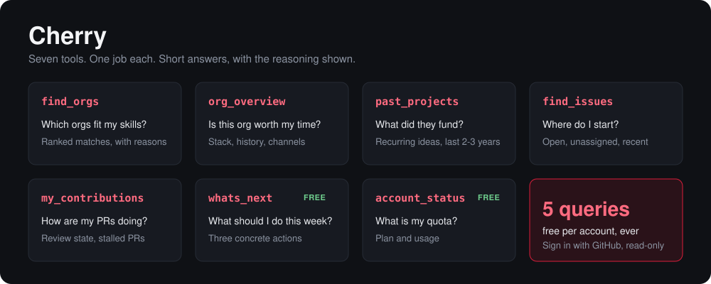

<div align="center">
  
  <h1>Cherry</h1>
  <p><b>Open-source contribution coaching, delivered as a remote MCP server.</b></p>
  
  
  
  
</div>

<br/>

<div align="center">
  
</div>

## What it is

Cherry connects to Claude (or any MCP client) and answers the questions students actually have when they start contributing to open source: which organization fits my skills, where do I begin, and how are my pull requests going.

It was built for students preparing for Google Summer of Code, and it works for anyone trying to make their first real contributions.

Answers are short and structured. Numbers show how they were computed, estimates are marked as estimates, and every org record carries a `last_verified` date.

## Tools

Each tool has one job and a clear trigger. In a chat, just ask in plain language and the client picks the right one.

| Tool | When | What it does |
| :--- | :--- | :--- |
| `find_orgs` | Choosing where to contribute | Ranks organizations against your skills and explains each match. |
| `org_overview` | Before committing to an org | Stack, participation history, beginner-friendliness, contributing guide, and chat channels. |
| `past_projects` | Understanding what an org funds | Projects from the last two to three years and the ideas that keep coming back. |
| `find_issues` | Looking for a first contribution | Open, unassigned, recently active issues filtered by your skills and chosen org, with etiquette tips. |
| `my_contributions` | After you have opened PRs | Your PRs in an org: state, linked issues, review status, last maintainer response, stalled ones, and the next step for each. |
| `whats_next` | Any time (free) | Three actions for this week, based on the calendar and your own gaps. |
| `account_status` | Any time (free) | Your plan and remaining queries. |

## Example conversations

```text
Which orgs fit someone strong in Python and Django, with some Docker experience?

Is this org beginner-friendly? What did they work on in the past two years?

Find me open issues in this org I can start with this weekend.

Which of my PRs are stalled, and what should I do about each?

What should I focus on this week?
```

## Connect

1. In Claude, open **Settings → Connectors → Add custom connector**.
2. Enter `https://<your-domain>/mcp`.
3. Click **Connect** and sign in with GitHub.
4. Approve read-only access.
5. Ask a question.

Cherry also works with Claude Code and the MCP Inspector. Any client that supports remote MCP over Streamable HTTP with OAuth will do.

## Plans

Each account gets **5 billable queries, ever**, so you can try the strongest tools once. `whats_next` and `account_status` are always free. When you reach the limit, Cherry says so plainly and tells you how to continue. A season pass is planned after launch.

## Principles

**Answers, not data dumps.** Every tool returns the smallest response that fully answers the question.

**Honest signals.** Scores are guidance, not odds. Nothing is presented as a guarantee, including readiness.

**Respect maintainers.** Cherry steers you toward one or two orgs, reading the contributing guide first, introducing yourself once, small PRs before big ones, and answering review comments quickly.

**Your work stays yours.** Cherry does not write proposals, open PRs, comment on issues, or message maintainers. Asked to, it declines and offers structure, checklists, and feedback instead.

## How it works

```text
Claude / MCP client
        |  HTTPS, Streamable HTTP, Bearer token
        v
Public listener :3000   /mcp  /oauth/*  /auth/github/*  /.well-known/*  /health
        |  loopback only
        v
Private API 127.0.0.1:4001   /v1/*   data, logic, auth, quota
        |
        +-- PostgreSQL   source of truth
        +-- Redis        cache, short-lived OAuth state
        +-- GitHub API   REST + GraphQL, ETag-cached
```

- **MCP is a thin front.** Tools translate intent into API calls and trim the result. They never touch the database.
- **The API is private.** It is bound to loopback, so "the API sits behind MCP" is enforced by the network, not by convention.
- **Two kinds of GitHub data.** Shared org metrics are precomputed with a server-side token. Personal data, like your PRs, uses your own token and is cached for five minutes.
- **Failures are readable.** Quota limits, GitHub rate limits, and revoked tokens come back as plain text the model can relay, not opaque errors.

## Privacy and security

- Sign-in is through GitHub OAuth. Cherry never sees a password.
- The only scope requested is `read:user`. Cherry never asks for `repo` and never writes to GitHub.
- GitHub tokens are encrypted at rest and never returned to the client.
- Cherry issues its own tokens to clients. They are stored hashed, with refresh rotation, PKCE, exact redirect URI matching, and single-use authorization codes.

## Data

The v1 dataset covers about 30 organizations, chosen as a mix of beginner-friendly and mid-competition projects rather than only the famous ones. Each record includes stack, difficulty, past projects, ideas page, contributing guide, chat channels, and a `last_verified` date. A nightly job refreshes the issue index and activity metrics, and flags any record not verified in 30 days.

Always confirm dates and rules on the official program pages before acting on them.

## Development

```bash
git clone <repo-url> cherry && cd cherry
cp .env.example .env
docker compose up -d      # Postgres + Redis
npm install
npm run migrate
npm run seed
npm run dev
```

Script names are placeholders; match them to `package.json`. Test against `http://localhost:3000/mcp` with the MCP Inspector.

| Variable | Purpose |
| :--- | :--- |
| `DATABASE_URL`, `REDIS_URL` | Postgres and Redis connections |
| `GITHUB_CLIENT_ID`, `GITHUB_CLIENT_SECRET` | GitHub OAuth app. Callback: `https://<your-domain>/auth/github/callback` |
| `GITHUB_SERVER_TOKEN` | Server-side token for shared org data |
| `TOKEN_ENCRYPTION_KEY` | Encrypts stored GitHub tokens |
| `INTERNAL_API_KEY` | Shared secret between MCP and the private API |
| `PUBLIC_BASE_URL` | Public origin used in OAuth metadata |

## Roadmap

Season-pass billing, `my_readiness`, `manage_shortlist`, `past_proposals`, and a separate worker process.

## Contributing

Corrections to org data are the most useful contribution. Open an issue or PR and include a source link.

## Why

I build software for a living, and I've watched capable students lose weeks to scattered information and bad advice: picking orgs by hype, sending a burst of low-quality PRs, or never starting at all. Cherry is the tool I wish they had: a small set of tools with honest answers and good habits built in.

## Support

If Cherry helped you, star the repo, share it with someone preparing, or open an issue.

## License

MIT